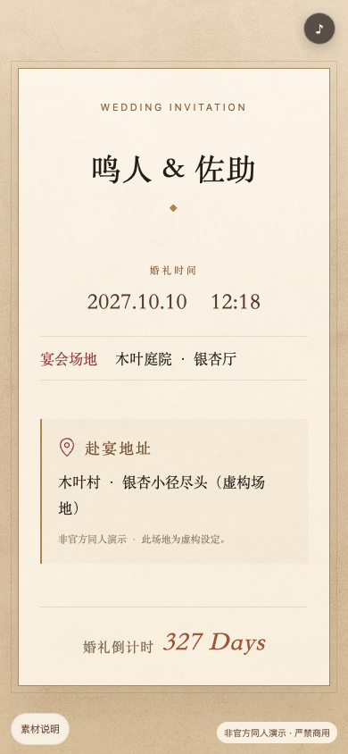
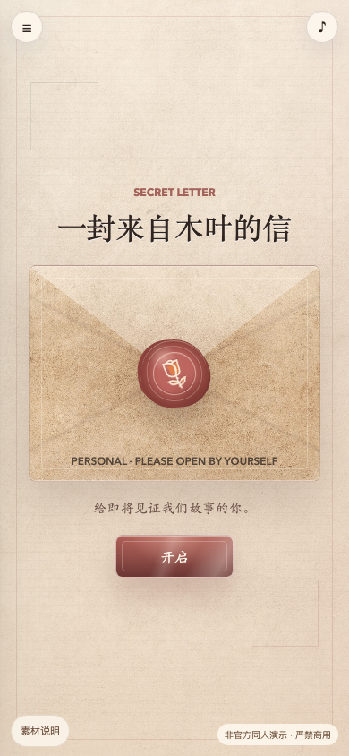
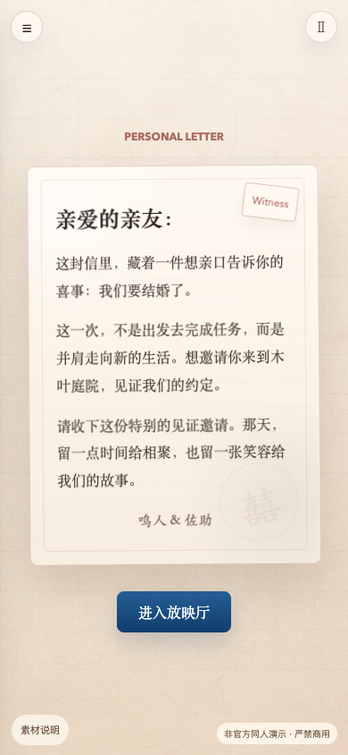
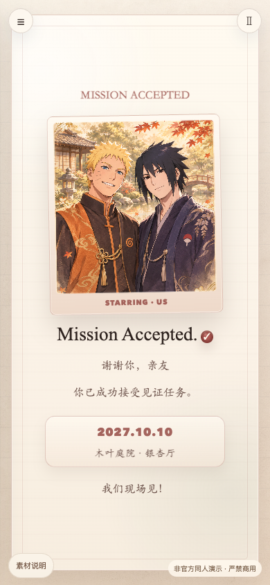

# 婚礼请柬 Skills

两个可独立安装的 Codex skill，用自然语言制作手机婚礼请柬。

| Skill | 体验 | 默认视觉与分享图 |
| --- | --- | --- |
| `create-wedding-invitation` | 四屏经典请柬、连续照片放映、地点卡片；支持 PNG、PDF、一图版 | 先询问西式或中式；西式经典米白，中式红色纸纹。分享图优先封面照片 |
| `create-witness-wedding-invitation` | 神秘信封、身份互动、专属来信、照片放映、见证任务 | 复古信纸；分享图默认使用信封图 |

## 效果预览与在线体验

同一份虚构邀请，两种打开方式。以下为「鸣人 & 佐助」非官方同人功能演示，日期、场地与故事文案均为虚构，不代表原作设定，也不代表与原作或权利人存在关联。

### 经典展示版

米白纸纹封面、连续胶片放映、重点清晰的赴宴信息，以及深暖棕纸纹结尾。

<p>
  
  
  
</p>

[打开经典版在线体验](https://narusasu-classic-demo.pages.dev/)

### 见证者模式

从拆开神秘信封开始，经过身份互动、专属来信、照片放映，再领取见证任务。接受任务仅展示互动效果，不收集出席回执。

<p>
  
  
  
</p>

[打开见证者模式在线体验](https://narusasu-witness-demo.pages.dev/)

> **非官方同人演示，严禁商用。** 角色及动漫素材版权归各自权利人；此标注不授予宣传、转载或再分发许可。截图仅用于展示 Skill 的生成效果，不作为可复用素材提供。在线演示为公开静态网页，身份互动不是访问保护。截图只保存在 `docs/showcase/`，未将本案例的原始插画、图库、请柬配置或整站 ZIP 加入两个 Skill 的安装目录。

## 当前发布状态

这是公开的 Skill 仓库。两版沿用原项目 BGM、纸纹及信封等素材，统一标注“严禁商用”。未使用后来寻找的卡农或替代纸纹，不能将备选素材的 CC0／CC BY 许可套用在当前默认素材上。网页和发布包保留说明，详见 [素材清单](ASSET_LICENSES.md) 与 [许可说明](LICENSE.md)。非商业标注不等于权利人授权，使用与再分发前仍需自行确认相应权限。

仓库包含模板、脚本、说明、虚构示例与文档展示截图，不包含实际婚礼项目、私人宾客名单或登录资料。上方链接仅指向明确公开的虚构演示。

## 安装与开始

在 Codex 中提供这个仓库的地址，并说：“请安装仓库中的 create-wedding-invitation 和 create-witness-wedding-invitation 两个 skill。”也可将各 skill 文件夹复制到自己的 Codex skills 目录，通常为 `~/.codex/skills/`。安装后在新任务中尝试：

> 我想用经典版 skill 做请柬，想要中式红色纸纹。

或：

> 我想用见证者模式 skill 做一份婚礼来信。

接下来逐步提供双方姓名、姓名展示顺序、婚礼日期与时间、酒店和宴会厅、照片。可以先看结构预览，再补素材；见证者模式在通用版确认可用后，可以复用照片和婚礼信息，为不同亲友制作专属称呼和信件。

两版都需要用户明确姓名展示顺序。见证任务的接受按钮只展示互动效果，不收集出席回执，也没有后台。

## 本地运行与示例

需要 Python 3.10 或更新版本。网站生成、校验和 ZIP 打包只使用 Python 标准库。以下命令在仓库根目录运行；Windows 可用 `py -3` 代替 `python3`。

```bash
python3 create-wedding-invitation/scripts/create_invitation.py --config examples/classic.json --output output/classic
python3 create-wedding-invitation/scripts/validate_invitation.py output/classic
python3 -m http.server 8000 --directory output/classic
```

浏览器打开 `http://127.0.0.1:8000/`。见证者版另开终端运行：

```bash
python3 create-witness-wedding-invitation/scripts/create_witness_invitation.py --config examples/witness.json --output output/witness
python3 create-witness-wedding-invitation/scripts/validate_witness_invitation.py output/witness
python3 -m http.server 8001 --directory output/witness
```

示例使用虚构信息、关闭音乐、不包含照片，因此校验出现缺照片和未配置公开分享地址的提醒是预期结果。它们只是结构预览，不能直接作为最终请柬发送。生成器拒绝覆盖已有目录，重新生成时换一个输出目录。

经典版图片与 PDF 导出另需 Node.js 20 或更新版本、Playwright 和 Chromium：

```bash
npm ci
npx playwright install chromium
node create-wedding-invitation/scripts/export_invitation.mjs --site output/classic --output output/exports --formats poster
```

也可用 `--formats cover,long,pdf` 导出封面、长图及 PDF。默认输出路径已被 Git 忽略。导出为静态文件，不包含音乐、轮播和动态倒计时。

## 分享与发布

本地回环链接只能在运行预览的设备上打开，远方亲友不能使用这个地址。最终素材和文案确认后，skill 会询问是否需要上传到 Cloudflare Pages 等静态托管服务，得到授权后协助发布并提供 HTTPS 链接；不要求使用 GitHub 托管请柬。

上传前确认照片和文案允许公开，检查照片元数据。来信身份互动及 `noindex` 都不能保护静态网页里的内容。分享图需要公开可访问的 HTTPS 图片地址；微信的实际展示需要在微信中检查。登录密码、验证码、验证链接与安全验证由用户本人处理，不应写入请柬配置、仓库或打包文件。详见 [隐私与发布边界](PRIVACY.md)。

## 验证与维护

```bash
python3 tools/verify.py
```

安装 Playwright 后，运行 `node tools/browser-verify.mjs` 可验证两版手机页面、音乐循环与暂停、相册拖动及见证者流程；只使用虚构信息，报告保存在被忽略的 output/。可用 WEDDING_BROWSER_PATH 指定现有浏览器。

验证会在临时目录生成并校验两版、检查姓名顺序与主题配置、默认信封分享图、未知字段拒绝和 ZIP 内容。测试不登录服务、不上传网页。浏览器中的手机比例、纸纹、轮播拖动、音乐、见证者完整流程仍需按各 skill 的检查指引实际预览。修改时更新两个 skill 各自的源文件；不要复制生成的实际请柬回模板。

可选的 GitHub Actions 检查模板位于 `tools/verify-workflow.example.yml`。仓库当前未启用工作流；拥有相应工作流写入权限时，可将模板复制到 `.github/workflows/verify.yml`。本地验证不受影响。

示例配置见 [examples](examples/)，脱敏预览见 [docs/previews](docs/previews/)。asset-sources 中先前下载的替代素材仅为历史备选，未接入默认模板。运行 `node tools/build-assets.mjs` 只会更新原素材说明与校验值，不改写素材。公开前仍需完成的事项见 [ASSET_LICENSES.md](ASSET_LICENSES.md)。
