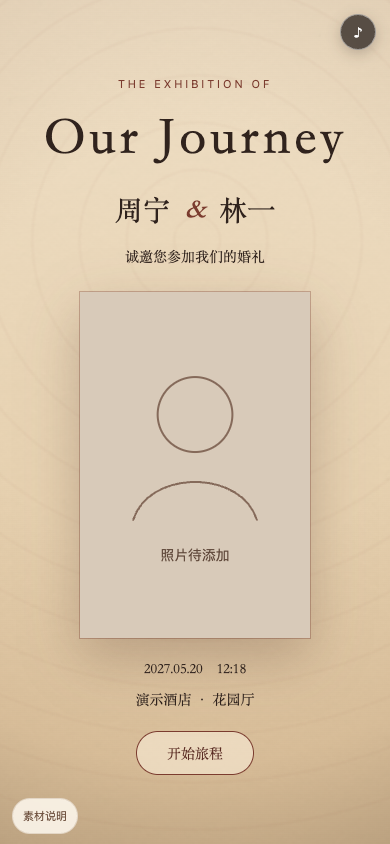
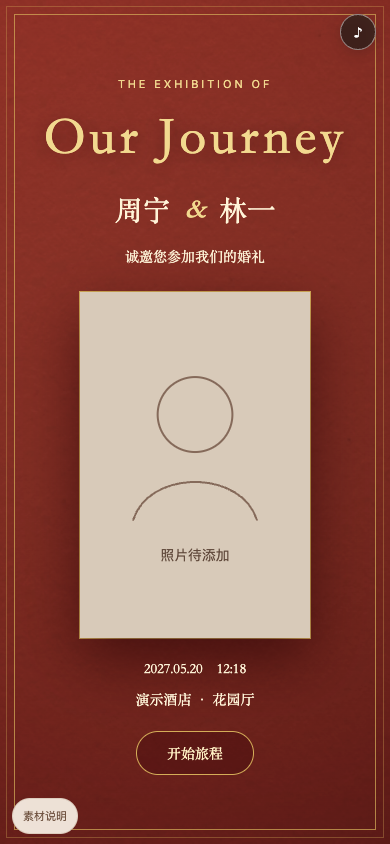
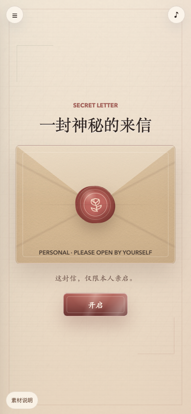

# 脱敏预览

预览图使用仓库内的虚构示例配置，尺寸为 390 × 844；无真实新人照片、宾客或实际婚礼信息。经典版缺照片时展示占位，不能将这些预览视作最终请柬。

| 经典米白 | 中式红色纸纹 | 见证者信封 |
| --- | --- | --- |
|  |  |  |

图中纸纹来自 CC0 素材，信封和占位为本项目新绘图形。最新来源及许可见仓库根目录的 ASSET_LICENSES.md。

复现：安装 Playwright 与 Chromium 后，在仓库根目录运行 `node tools/browser-verify.mjs`，它会生成三张封面预览并验证交互；相册中用新信封图作测试夹具，不将其作为人物照片。也可按根目录 README 生成两个示例，在 8000 和 8001 启动本地服务后运行 `node tools/preview.mjs`。可通过 WEDDING_BROWSER_PATH 指定本机已有浏览器，实际机器路径不应提交。
